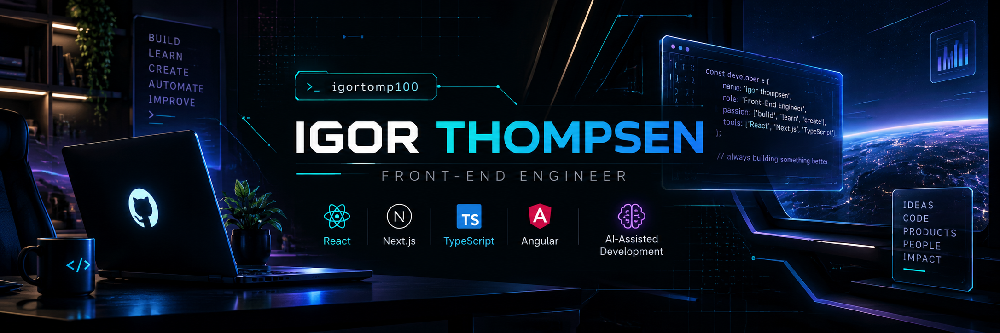

  

# 👨‍💻 About me

Hi there! 👋

I'm a **Front-End Engineer** with over 16 years of experience in software development.

I specialize in building scalable applications using React, Next.js, Angular and TypeScript.

👉 Check out my **pinned projects** below — the same ZIP code app built with Angular ([live demo](https://angular-cep-search.vercel.app/)) and React Native.

### 🛠️ My favorite technologies

- ⚛️ React.js & Next.js
- 🔷 TypeScript & JavaScript
- 🅰️ Angular
- 🟢 Node.js
- 🚀 GraphQL & Apollo Client
- 🧪 Jest, Cypress & React Testing Library

### 🌱 Currently learning

AI-Assisted Development, SDD, AI Agents and Hexagonal Architecture.

### 🎻 When I'm not coding

I play *rabeca* (a traditional Brazilian fiddle) at home.

### 📫 Connect with me

- 🌐 Portfolio: [igorthompsen.vercel.app](https://igorthompsen.vercel.app/)
- 💼 LinkedIn: [in/igorthompsen](https://www.linkedin.com/in/igorthompsen/)
- ✉️ Email: [igortomp100@gmail.com](mailto:igortomp100@gmail.com)
